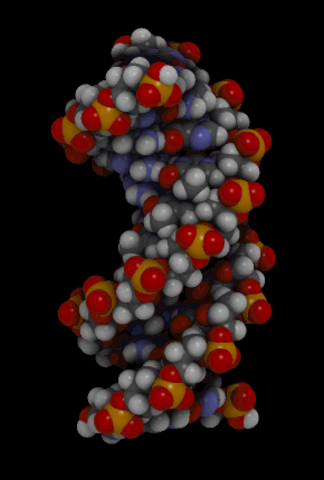
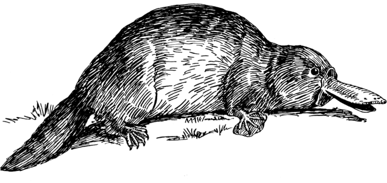
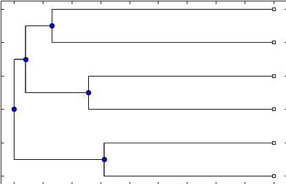
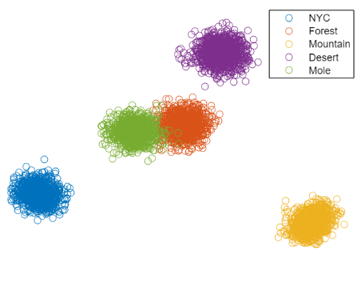
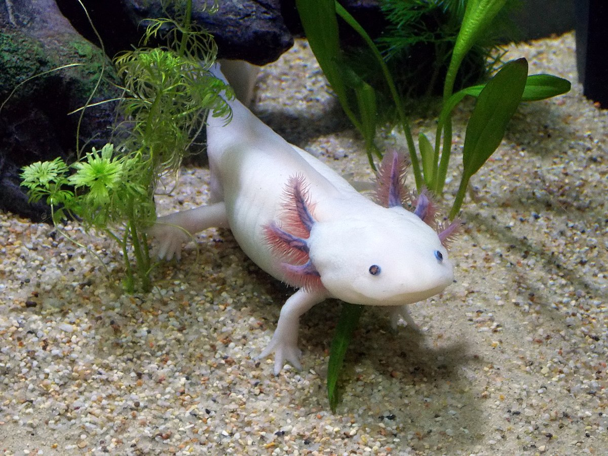
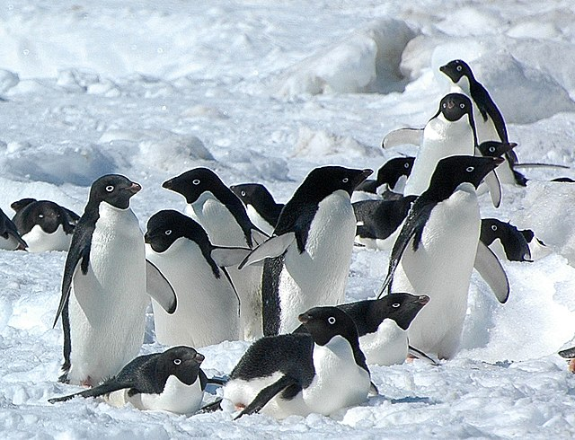
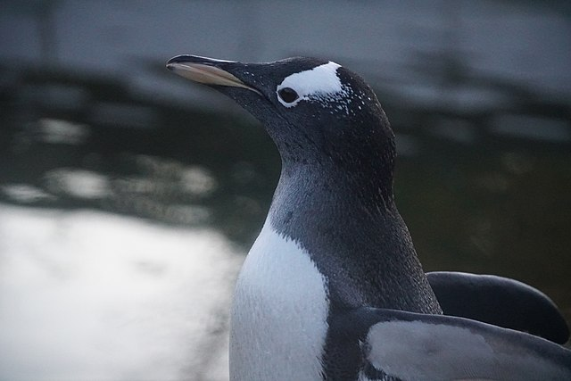
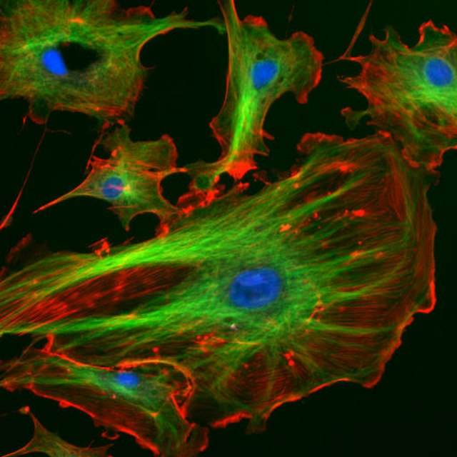

# Biosciences: Genetics

For MATLAB R2024b or older, use the [legacy MLX release](https://github.com/MathWorks-Teaching-Resources/Biosciences-Genetics/releases/tag/mlx).

 

**Curriculum Module**

_Created with R2025a. Compatible with R2025a and later releases._

# Information

This curriculum module contains interactive [MATLAB® live scripts](https://www.mathworks.com/products/matlab/live-editor.html) that analyze genetic data. 

## Background

You can use these live scripts as demonstrations in lectures, class activities, or interactive assignments outside class. This module covers calculating the statistics of a single DNA sequence, uses real genetic data to create a phylogenetic tree, and explores within\-species genetic variation. 

This module utilizes data pulled from [GenBank](https://www.ncbi.nlm.nih.gov/genbank/), the NIH's library of publicly available genetic sequences.

[A 3\-dimensional model of DNA](https://commons.wikimedia.org/wiki/File:Bdna_cropped.gif)

An internet connection is needed for GenBank sequence retrieval and the initial download of the primates example. Downloaded data belongs in `Data/` and is excluded from version control. Population data is simulated locally.

The instructions inside the live scripts will guide you through the exercises and activities. Get started with each live script by running it one section at a time. To stop running the script or a section midway (for example, when an animation is in progress), use the  Stop button in the **RUN** section of the **Live Editor** tab in the MATLAB Toolstrip.

## Contact Us

Contact the [MathWorks Educator Content Development Team](mailto:onlineteaching@mathworks.com) if you would like to request assistance, provide feedback, or if you have a question.

## Prerequisites

This module assumes basic MATLAB knowledge and it is recommended that all students take the [MATLAB Onramp](https://matlabacademy.mathworks.com/details/matlab-onramp/gettingstarted).

# Getting Started

To learn more about opening and using MATLAB, see the accompanying [Getting Started](http://gettingstarted.pdf) guide. 

### Accessing the Module

Use MATLAB R2025a or newer for these plain\-text live scripts. For MATLAB R2024b or older, download the [legacy `.mlx` release](https://github.com/MathWorks-Teaching-Resources/Biosciences-Working-With-Data/releases/tag/mlx).

### **On MATLAB® Online**™:

Use the  link to download the module. You will be prompted to log in or create a MathWorks account. The project will be loaded, and you will see an app with several navigation options to get you started.

### **On Desktop:**

Download or clone this repository. Open MATLAB, navigate to the folder containing these scripts and double\-click on [BiosciencesGenetics.prj](<matlab: openProject("BiosciencesGenetics.prj")>). It will add the appropriate files to your MATLAB path and open an app that asks you where you would like to start. 

Ensure you have all the required products ([listed below](#M_5d15)) installed. If you need to include a product, add it using the Add\-On Explorer. To install an add\-on, go to the **Home** tab and select   **Add-Ons** > **Get Add-Ons**. 

# Products

MATLAB®, Bioinformatics Toolbox™, and the Statistics and Machine Learning Toolbox™ are used throughout. The Mapping Toolbox™ is used for `changem()`.

# Scripts

Notes: These scripts can all be run independently, though we recommend going through these live scripts in order. These live scripts are intended to be used with output inline. To change the output, go to the View tab of the toolstrip, and select  Output Inline. The scripts have areas for the students to interact with the code . 

## [Explore a single DNA sequence](<matlab: edit Scripts/S1ExploreSingleDNASequence.m>)
||||
| :-- | :-- | :-- |
|     | **In this script, students will...**   $\bullet$  import and analyze DNA sequences in MATLAB, and visualize nucleotide content    | **Academic disciplines**   $\bullet$ Biology     |

## [Comparative genetics](<matlab: edit Scripts/S2ComparativeGenetics.m>)
||||
| :-- | :-- | :-- |
|     | **In this script, students will...**   $\bullet$ calculate genetic distances between species   $\bullet$ visualize genetic distance using phylogenetic trees   $\bullet$ use genetic data to interpret evolutionary relationships    | **Academic disciplines**   $\bullet$ Biology     |

## [Population genetics](<matlab: edit Scripts/S3PopulationGenetics.m>)
||||
| :-- | :-- | :-- |
|     | **In this script, students will...**   $\bullet$  visualize genetic differences within a population using dimensionality reduction    | **Academic disciplines**   $\bullet$ Biology   $\bullet$ Machine Learning   $\bullet$ Linear Algebra     |

## [Problem Set](<matlab: edit Scripts/S4ProblemSet.m>)
||||
| :-- | :-- | :-- |
|     | **In this script, students will...**   $\bullet$ retrieve and plot nucleotide data   $\bullet$ create phylogenetic trees   $\bullet$ visualize genetic differences within a population using dimensionality reduction    | **Academic disciplines**   $\bullet$ Biology   $\bullet$ Machine Learning   $\bullet$ Linear Algebra     |

# **Further Resources for students**

&#160;&#160;&#160;&#160;&#160;&#160;&#160;&#160; 1) [an example of phylogenetic trees using the primate dataset](https://www.mathworks.com/help/bioinfo/ug/building-a-phylogenetic-tree-for-the-hominidae-species.html)

&#160;&#160;&#160;&#160;&#160;&#160;&#160;&#160; 2) [an example of using phylogenetic trees to understand a disease](https://www.mathworks.com/help/bioinfo/ug/analyzing-the-origin-of-the-human-immunodeficiency-virus.html)

&#160;&#160;&#160;&#160;&#160;&#160;&#160;&#160; 3) [more on sequence statistics](https://www.mathworks.com/help/bioinfo/ug/calculating-and-visualizing-sequence-statistics.html)

# Related Courseware Modules

| **Courseware**    |  | **Location**     |
| :-- | :-- | :-- |
| [Biosciences: Working With Data](https://www.mathworks.com/matlabcentral/fileexchange/181586-biosciences-working-with-data)     |     | **Available on:**          [GitHub](https://github.com/MathWorks-Teaching-Resources/Biosciences-Working-With-Data)      |
| [Biosciences: Statistical Methods](https://www.mathworks.com/matlabcentral/fileexchange/163691-biosciences-statistical-methods)     |     | **Available on:**          [GitHub](https://github.com/MathWorks-Teaching-Resources/Biosciences-Statistical-Methods)      |
| [Biosciences: Image Processing](https://www.mathworks.com/matlabcentral/fileexchange/163701-biosciences-image-processing)     |     | **Available on:**          [GitHub](https://github.com/MathWorks-Teaching-Resources/Biosciences-Image-Processing)      |
| [Biosciences: Machine Learning](https://www.mathworks.com/matlabcentral/fileexchange/163696-machine-learning-for-biosciences)     |      | **Available on:**          [GitHub](https://github.com/MathWorks-Teaching-Resources/Biosciences-Machine-Learning)      |

Or feel free to explore our other [modular courseware content](https://www.mathworks.com/matlabcentral/fileexchange/?q=tag%3A%22courseware+module%22&sort=downloads_desc_30d).

# Educator Resources
- [Educator Page](https://www.mathworks.com/academia/educators.html)
- [Instructor Resources](InstructorResources/Documentation/README.md)

# Contribute 

Looking for more? Find an issue? Have a suggestion? Please contact the [MathWorks Educator Content Development Team](mailto:onlineteaching@mathworks.com). If you want to contribute directly to this project, you can find information about how to do so in the [CONTRIBUTING.md](CONTRIBUTING.md) page.

# License

The license for this project is in the [LICENSE.md](http://license.md) file in this repository.

# Help us Improve

[Share your feedback](<matlab: ShareFeedback>) to help us improve this module.

© Copyright 2023\-2026 The MathWorks, Inc.
